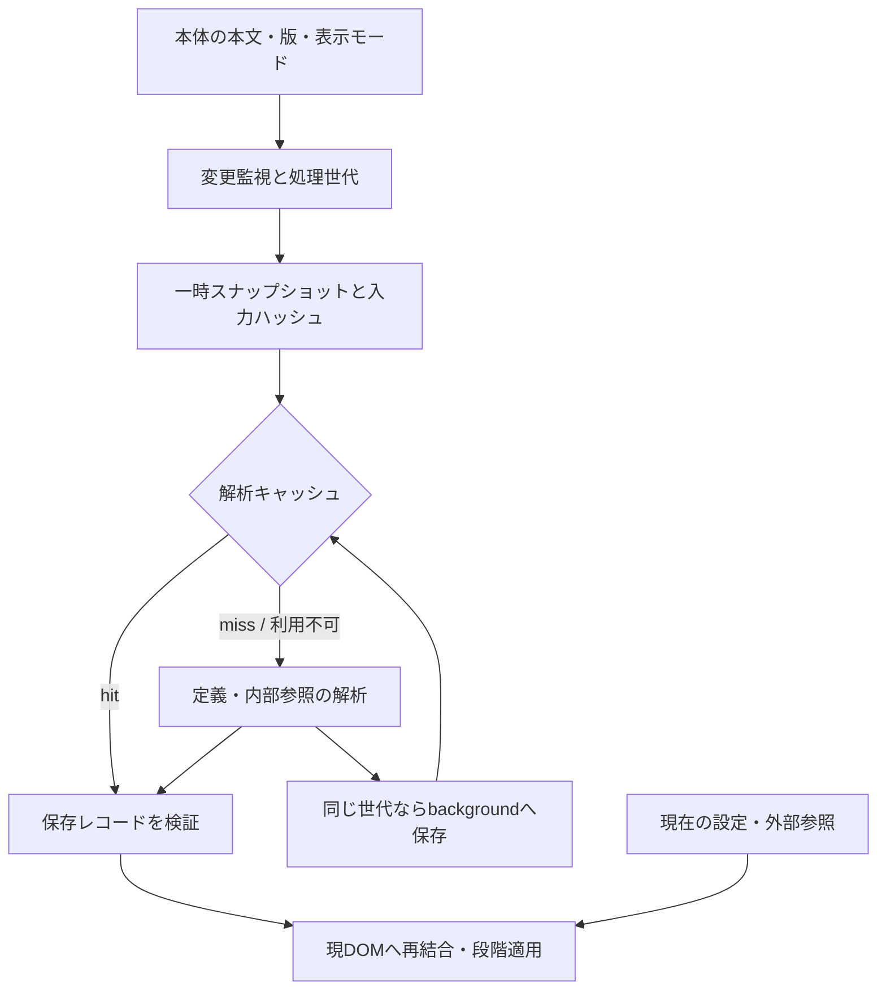

# 通常モード加工キャッシュ：実装設計案

作成日：2026-10-16（日本時間）  
対象：e-Gov法令検索 Enhancer 2.6.2、HEAD `bb84aa6`  
状態：実装前の提案。以下のファイル名・API名・数値は新設案であり、現コードに実装済みという意味ではない。

2026-10-16追記：簡素化の観点で再検証した結果、本案は初期実装として範囲が広すぎると判断した。原案として本文を残す。現在の推奨は別紙 [簡素化レビュー](簡素化レビュー.md) を参照。

## 1. 推奨する実装範囲

**最初に、通常の条文表示を対象に、定義辞書と同一法令内の逆参照の解析結果を保存する。** 本文スナップショットとDOMへの再結合を共通化し、保存を無効にした場合にも同じ解析・表示結果になる構成にする。

初期版に含めるもの：

- 本則／附則、条／第1項、枝番号を区別できる内部キー。
- 表示版・表示モード・本文変更の追跡と、処理途中のキャンセル。
- 一時スナップショット、定義抽出、内部参照解析、現DOMへの適用。
- background経由のIndexedDB保存、破損・遅延・容量不足時の通常解析。
- 処理区間の計測と、保存ON/OFFの比較。

後続版に分けるもの：

- 定義語の出現位置、括弧範囲、検索索引の永続保存。
- 数字・かな変換前後の文字位置を対応させる仕組み。
- 外部参照データの世代管理・取込直後の自動更新。
- 条文比較・引用元表示向けの加工キャッシュ。
- e-Gov本体の通信を省略する仕組み。

既存LiteのXMLキャッシュ、個人ハイライト、ブックマークの保存形式は初期版の変更対象にしない。

## 2. 初期版で固定する判断

| 論点 | 採用案 | 理由 |
|---|---|---|
| 保存するもの | 定義の保存用レコード、内部参照の関係と参照元抜粋 | Element・イベントを保存せず、解析の再利用範囲を絞れる |
| 保存しないもの | HTML、Element、Range、WeakMap、画面座標、ユーザーのメモ | DOMや個人状態との結合を防ぐ |
| 保存先 | backgroundが所有する専用IndexedDB | サイト側の保存領域や既存参照DBと分離できる |
| 改正ID | 可視ラベルとURLを照合して補助情報として採用 | 表示先行や取得不能があるため本文ハッシュも必須 |
| 完成判定 | 「法令全文完成」ではなく「この入力の解析が完了」 | 本体の全文完成信号は未特定。部分入力を完全な法令と誤認しない |
| 本文の変化 | 即時に旧処理を失効し、安定後に再捕捉 | 古い結果の適用・保存を防ぐ |
| DOMだけの作り直し | 同じ入力なら保存解析を使い、結合し直す | 内容とDOM実体の寿命を分ける |
| 数字・かな変換後 | 初期版では永続保存を迂回し、現在表示の通常解析を使う | 変換前の本文を復元する追加設計を持ち込まない |
| 括弧・定義マーク等 | 指定した拡張ラッパーだけを透明化して捕捉 | ネイティブ構造は保持し、自己加工でキーが変わるのを防ぐ |
| 内外逆参照の統合 | 表示時のメモリ内処理 | 外部データ世代の設計を初期版の保存に持ち込まない |
| 既存キーとの互換 | 新しいキーを解析内部に限定 | 保存済みブックマーク・ハイライト・ジャンプ履歴の一斉移行を避ける |

## 3. 構成と担当箇所



| ファイル | 新設／変更内容 |
|---|---|
| 新規 `shared/law-analysis-core.js` | scope付きキー、バージョン、保存レコードの検証、キーの決定的な直列化。DOM・chromeに依存しない |
| 新規 `shared/normal-law-snapshot.js` | 通常モードの捕捉、ネイティブ構造の再現、入力ハッシュ、現DOMの結合索引 |
| 新規 `shared/law-analysis-cache-background.js` | IndexedDB、get/put/delete、容量管理、更新競合の直列化 |
| `content-controller.js` | 本文rootの再発見、変更分類、世代、安定待ち、キャンセル可能な実行管理 |
| `content.js` | 定義抽出の入力を引数化、定義レコードの変換と再結合、内部参照の取得・適用の統合 |
| `shared/egov-shared.js` | 既存の内部参照解析に、版文脈を渡す任意引数等を追加。Lite既定動作を維持 |
| `background.js` | 新モジュールの読み込み、新メッセージの振り分け |
| `manifest.json` | core→snapshot→controller→contentの順になるよう共有スクリプトを登録。権限追加なしを前提 |
| `tools/package-extension.ps1` | 配布物から `docs/research/` を除外。新共有スクリプトは既存shared収録に含まれることを確認 |
| 新規テスト群 | 下記の不変条件と通常モードDOMでの統合検証 |

`viewer.js` と外部ファイル同期の既存変更3ファイルには、初期版で変更を加える必要はない。共有関数の追加引数は省略可能とし、Liteへの副作用を避ける。

## 4. 入力と出典の識別

### 4.1 文脈

```js
context = {
  lawId: "405AC0000000088",
  documentUrl: "https://laws.e-gov.go.jp/law/...", // hashを除く表示中URL
  displayedRevisionId: "..." || null,
  revisionConfidence: "confirmed" | "unknown" | "conflict",
  occasionDate: "20240401" || null,
  viewMode: "text",
  domAdapterVersion: 1,
  textPolicyVersion: 1
};
```

URLのpathと検索パラメータは保持し、ページ内ジャンプのhashだけを外す。未知の検索パラメータを安易に捨てない。検索パラメータの並びは決定的に整列する。現行URLと版指定URLの統合は初期版では行わず、同じ内容でも別キーになることを許容する。

`.revisionid` の可視ラベルを読み、法令IDが一致する唯一の候補があれば採用する。URLにも版のsuffixがある場合は一致を確認する。候補がない場合は `unknown` とし、内容ハッシュとURLで区別する。候補が複数／不一致なら `conflict` とし、その状態では保存を使わず画面の更新を待つ。ラベル取得成功は本文完成の意味ではない。

通常表示の確認にはURLの `tab`、実際の表示オプション、認識可能な本文構造を使う。不一致、比較表示、引用元表示、条文0件は `unsupported/waiting` とし、0件法令のキャッシュを作らない。

### 4.2 正確な出典キーと逆参照対象キーを分ける

現共有関数 `canonicalizeReferenceTargetKey()` は第1項を条へまとめる。定義出典の識別には流用しない。

```text
ExactProvisionKey（新設）
  本則 第2条                 = 2
  本則 第2条第1項            = 2.1
  本則 第2条第1項第3号の2    = 2.1.3-2
  附則Sp_1 第2条第1項        = Sp_1::2.1

ReferenceTargetKey（既存規則）
  第2条第1項へのリンク       = 2
```

数値部分の枝番号は `_`→`-` に統一し、scopeの `Sp_1` はそのまま保持する。キー生成には `parseProvisionHash()` を基礎として使う。定義候補のグループは `scope + article` とし、本則と附則を混ぜない。

ただしキーだけでは `.article` と見出し等が同じ条を表す場合に一意にならない。定義の出典は次を組み合わせる。

```js
sourceBinding = {
  exactKey: "Sp_1::2.1.3-2",
  role: "article" | "paragraph" | "item" | "subitem",
  domId: "法令ID-Sp_1-At_2-Pr_1-It_3_2",
  sourceTextHash: "sha256:..."
};
```

結合は必ず現在の本文root内で行い、可視対象・role・scope・キー・本文照合が一致する唯一の候補だけを採用する。`document.getElementById()` の先頭一致や、別scopeへのフォールバックは行わない。本文の実質的な出典候補が重複して一意化できない入力では、永続キャッシュを迂回する。

### 4.3 スナップショット

```js
snapshot = {
  context,
  inputDigest,
  domEpoch,
  capturedAt,
  canonicalRoot,        // 一時的な切り離されたDOM。保存・転送しない
  visibleArticleIds,
  provisionRecords,
  liveBindingIndex      // 現DOM要素の索引。保存・転送しない
};
```

最初から抽出ロジック全体を文字列だけの解析器へ書き換えず、現在のセレクター・本文整形を利用できる切り離しDOMを一度だけ作る。複数候補の整形にこの入力を共有し、hit時は重い抽出を省く。捕捉そのものの費用は計測に含める。

捕捉の規則を固定する。

1. `#provisionview` 内の認識可能な通常本文を対象とする。定義候補のdocument全体探索をやめ、可視条文と同じ範囲に揃える。
2. 非表示の条文／候補を解析対象から除き、対象IDと順序を記録する。表示切替は再捕捉する。
3. 定義・括弧・参照番号の拡張ラッパーは、実装が所有するものだけ透明化して子の文字列を保つ。ポップアップ・余白ボタン・参照元proxy等は除く。
4. ネイティブ要素のtag、id、解析用class、入れ子、改行、ルビ、リンク位置とhrefを維持する。括弧の文字そのものは除かない。
5. 候補照合用のraw textと、ルビ除去等をした表示用テキストを混同しない。双方に影響する入力をハッシュへ含める。
6. リンクは捕捉時点の `documentUrl` で解決する。リンク先だけの変更でも別の入力になる。
7. 透明化したラッパーによるテキストノード分割は結合する。定義語のマーク適用は初期版では既存の単一テキストノード規則を維持し、キャッシュON/OFFで同じ現在DOMを使う。

安定した順序のトークン列を作り、SHA-256で `inputDigest` を求める。順序不定なオブジェクトの文字列化や、拡張が変更するinnerHTMLを直接キーにしない。捕捉と直列化・ハッシュはそれぞれ計測する。

## 5. 読み込み・適用・変更監視

### 5.1 処理トークン

```js
token = {
  pageEpoch,       // URL・root・表示版・モードの文脈
  domEpoch,        // 本体による本文／構造／属性の変更
  featureEpoch,   // その機能のON/OFF・設定変更
  signal          // AbortSignal
};
```

定義と逆参照の `featureEpoch` は別に持つ。逆参照の対象変更で定義抽出を捨てない。本文の差替えは両方を失効する。

すべてのawait後、同期解析の分割境界、DOM適用の各バッチ直前、保存要求の直前でトークン・root接続・有効設定を確認する。DBの応答は遅れて届いても、古いトークンなら適用しない。送信済みのDB処理が続く場合も、内容キーの異なる別の入力を上書きできない構造にする。

### 5.2 実行順

```text
対象表示を確認
  → 本文の出現・安定を待つ
  → スナップショット捕捉
  → 変更記録を確認、変化があれば破棄
  → メモリの同一入力結果を確認
  → 永続キャッシュを読み込む
  → hitなら保存レコード検証、missなら捕捉済み入力を解析
  → 現DOMへ出典を再結合
  → 有効設定と世代を再確認
  → 定義マーク／逆参照を段階適用
  → 解析完了かつ世代一致なら、missの結果を保存
```

初期値として、最後の関連変更から300msの安定待ちを設ける。これは全文完成保証ではなく、連続差替え中の無駄な解析を減らすための待ち時間である。継続的に変化する場合も一定間隔で入力候補を捕捉できるようにし、上限待ち2秒で試行する。捕捉中に変化した入力は適用・保存しない。

最初の条文待ちは既存と同程度の10秒を目安とし、タイムアウト後も本文監視を継続して次の出現を処理する。空配列の `getAllArticles()` メモリキャッシュを準備判定に使わず、現在のrootを直接確認する。

### 5.3 部分入力の扱い

レコードの意味は「このdigestの入力から得られた解析結果」であり、「この改正IDの全条文」ではない。条文の途中追加や除去でdigestが変われば再利用しない。

捕捉時点で一部の条文しかない場合でも、その入力の解析が完了すれば保存候補にはできる。ただし後続変更で直ちに再解析し、IDだけによる早期hitは絶対に行わない。部分入力の保存は表示完了の証拠には使わない。過渡的な入力を大量保存しないよう、保存前にも安定待ちを置き、同じ機能・同じページで未送信の古い保存候補は取り消す。

### 5.4 変更監視と自己加工の区別

本文rootでは `childList/subtree/characterData` と、`href/id/class/style/hidden` 等の解析・可視性に関わる属性を監視する。rootを含む本体の容器・版ラベル・表示オプションも監視し、rootそのものの置換を再発見する。root祖先の可視性変更も対象に含める。

自分の加工中だからという理由で監視を一括停止しない。各同期DOM適用バッチを管理関数で囲む。

1. 開始前に未処理の変更を排出・評価する。本体変更があればそのバッチを中断する。
2. 挿入／除去／属性変更したノードと値をそのバッチの記録に残す。
3. 同期処理の末尾で変更を回収し、記録と一致する自己変更だけを除外する。
4. 記録外の変更は同じバッチ中でも本体変更として処理する。バッチ内ではawaitしない。

「拡張spanの内部で起きた変更は全部無視」としない。後から本体がその文字を変更した場合は検出する。定義・括弧・番号補完など本文へ書き込む既存処理にも管理関数を通す。未対応の書込処理が残る間は保存を有効にしない。

URLは起動時、ナビゲーション通知が得られる時、各ジョブ・バッチの開始時に確認する。`popstate`だけでは同一ページ内の履歴更新を網羅しないため、本文／版／表示オプションの監視と組み合わせる。

## 6. 保存形式とbackground API

### 6.1 レコード

```js
{
  cacheKey: "sha256:...",
  schemaVersion: 1,
  kind: "definitions" | "internalReferences",
  processorVersion: 1,
  context,
  inputDigest: "sha256:...",
  payloadDigest: "sha256:...",
  payload: { /* 下記 */ },
  createdAt: 0,
  lastAccessedAt: 0,
  byteLength: 0
}
```

`cacheKey` はkind、schema、処理版、解析に影響するcontext、inputDigestの決定的な直列化から生成する。定義と内部参照は別レコードとし、個別にhit/missにできる。保存時刻やページ内の世代番号はキーに含めない。

定義：

```js
payload = {
  definitions: [{
    term: "不利益処分",
    definition: "...",
    sourceType: "patternB",
    targetDepth: 3,
    binding: sourceBinding
  }]
};
```

既存の `definitionMap` の `anchorEl/sourceEl/excludeEl` は、読み込み後にbindingから作り直す。用語の長さ等の既存制約、重複語の優先順位、別名定義より前を除外する規則を維持する。附則scopeの補正と可視本文への候補限定は、保存の有無に関係なく同じ解析器へ適用する意図的な修正とする。

内部逆参照：

```js
payload = {
  targets: [{
    targetKey: "2",
    sources: [{
      exactSourceKey: "3.1.2",
      sourceDomId: "Mp-Ch_1-At_3-Pr_1-It_2",
      sourceScope: "",
      sourceProvisionLabel: "第3条第1項第2号",
      sourceProvisionText: "..."
    }]
  }]
};
```

lawId・法令名・URLは結合時にcontextと現在の法令名から補い、既存の `externalLawSources` 形式へ変換する。外部参照とは表示直前に既存の `mergeLawReferences()` で統合する。外部参照のキャッシュや取り込み済みデータとの優先順位は変更しない。

### 6.2 メッセージ

```text
egov-law-analysis-get    { requestId, descriptor }
  → { ok:true, status:"hit", record }
  → { ok:true, status:"miss"|"unavailable", reason? }

egov-law-analysis-put    { requestId, record }
  → { ok:true, status:"stored"|"skipped", reason? }

egov-law-analysis-delete { requestId, cacheKey }
  → { ok:true }
```

descriptorはkind、schema、processor、context、inputDigestを含み、background側でもcacheKeyを計算する。応答のkind・文脈・入力・処理版をcontent側でも照合する。未知フィールドだけでhit判定しない。

DB読込は初期値400msで待つ。それを過ぎたら通常解析を始め、遅れて届いたhitへ切り替えない。同一ジョブ内で二重に画面適用しない。保存待ちは画面の適用完了を遅らせない。

### 6.3 保存先と容量

```text
DB: egov-normal-law-analysis
version: 1
store: entries          keyPath: cacheKey
index: lastAccessedAt
```

初期案は最大100レコード、JSONのUTF-8換算で合計32MiB、1レコード1MiBまで。数値は実測前の上限案であり推奨性能値ではない。IndexedDBやメッセージの実メモリ使用量がこの数字に収まるという保証ではない。

上限超過時は保存をスキップし、表示は続行する。全体上限は古いlastAccessedAtから削除し、表示中のメモリ結果には影響させない。未知スキーマ・不正payload・payloadDigest不一致はmiss扱いにして該当レコードのみ削除する。無関係な個人データ・Liteキャッシュを削除しない。

サイズ計算・ハッシュ・容量整理はIDBトランザクションの外で準備し、readwriteトランザクション内で外部awaitをしない。LRU更新・put・整理はbackground内で順序を管理し、同時要求でも上限・件数を壊さない。DBの成功応答はrequestの成功だけでなくtransactionの完了で判断する。`versionchange`で接続を閉じ、サービスワーカー再起動後もDBだけで復元できる構成にする。

## 7. 機能ごとの適用方針

### 7.1 定義

`extractDefinitions(snapshot)` と `bindDefinitions(records, snapshot.liveBindingIndex)` を分ける。hit時の全binding検証に失敗したら、その定義レコード全体をmiss扱いとし、同じ捕捉入力から再解析する。別の定義を都合よく落としてhit扱いにしない。

マーク検索は初期版では現在の本文テキストノードを走査する。解析辞書がhitしても、出現検索とspan作成の費用は残る。適用を時間予算約8msのバッチへ分け、各バッチでトークンを確認する。中断時はそのジョブが作ったマークを除去し、新ジョブのマークを巻き戻さない。

`getDefinitionApplySignature()` の弱い署名は保存キーにも適用済み判定にも使わない。入力digest・DOM世代・機能世代から、同じDOMへの重複適用だけを抑止する。

### 7.2 内部逆参照

`collectInternalLawReferences()` の解析結果を保存用構造へ変換する。参照範囲展開と既存の重複除去規則を維持する。表示側のバッチは現在の120対象を上限として残し、時間予算と世代検証を追加する。

本体の差替え時にも、定義等と同じ実行管理から内部参照の再収集／再結合を呼ぶ。`reverseReferenceScope` が変わった場合は、保存済み内部結果を維持して表示対象だけ切り替える。

同一法令の参照元は、現在のscope付き索引からその本文内へ移動できるようにする。新しいウィンドウ等へ開くURLは、hashを除いた捕捉文脈のURLに出典IDを付け、過去版を現行URLに置き換えない。

本体の引用ダイアログへ渡せるのは現在 `lawId/objectId` であり、過去版の指定が確認できていない。過去版の内部参照では、その経路に本文表示を委ねず、拡張側の参照元抜粋と本文内ジャンプを使う。既存の通常／Ctrl操作との対応を統合テストで固定する。外部法令のダイアログ経路は初期版では変更しない。

### 7.3 数字・かな・括弧との併用

数字／かな変換前にジョブを中断し、変換完了後に現在表示の通常解析を再予約する。初期版は、そのページで一度でも本文文字変換を実行した後は、見かけ上数字を戻しても永続キャッシュを使わない。新しい本文rootへの再構築時にのみ、未変換であることを確認して解除する。取得済み辞書を変換後DOMに無条件で結合しない。

括弧のラップは文字変換ではない。解析スナップショットでは透明化し、現在のノード構成へのマーク適用は保存OFF時と同じ規則を使う。ノード境界を跨ぐ用語までマークする改善は別変更とする。

## 8. 失敗・無効化の一覧

| 事象 | 保存解析 | 実行中ジョブ／表示 |
|---|---|---|
| 本文文字・href・構造変更 | 新digestはmiss。旧レコードはLRU対象として残せる | 旧ジョブ中断、古い加工を除去して再解析 |
| 同じ入力のroot置換 | 再利用可 | 必ず現DOMへ再結合 |
| 改正ID／URL／表示モード変更 | 別context、比較等は対象外 | 全機能の旧ジョブ中断 |
| 定義OFF | 維持 | 定義ジョブだけ中断・マーク除去 |
| 逆参照対象変更 | 内部結果は維持 | 逆参照だけ再適用 |
| 数字・かな変換 | そのページでは永続保存・再利用を迂回 | 現表示を通常解析 |
| キャッシュ破損・再結合不能 | 該当レコードをmiss扱い | 現入力から再解析 |
| DB／メッセージ失敗・容量超過 | 利用不可／保存スキップ | 通常解析・表示を継続 |
| 解析途中の例外 | 途中結果を保存しない | そのジョブの加工を巻き戻し、既存の失敗表示 |
| 外部参照取込 | 内部解析は維持、統合は保存しない | 初期版は既存の再読込導線で更新 |
| メモ・色・ブックマーク変更 | 維持 | 既存の個人表示だけ更新 |

外部参照の取り込み側には既存のページ再読み込み確認導線がある。初期版はこれを維持する。後続版で取込・削除の成功後にデータ世代を発行して通知する場合、IndexedDB更新との整合を別に設計する。`chrome.storage.onChanged`だけをIDB更新の自動通知と見なさない。

## 9. 実装を分ける単位と完了条件

### A. 正確性と計測の土台

- scope付き出典識別、入力・DOM・機能の世代、待機後の再確認、比較表示の対象外判定。
- 新しい捕捉入力を使う通常解析経路。本文加工の変更記録とキャンセル。
- 計測フック、通常モードDOMの固定フィクスチャ。
- 保存はまだ使わない。附則候補の誤混在等を独立した修正として確認する。

完了条件：キャッシュなしでA/B/C/D、附則、第1項、本文差替え、待機中OFF、数字・かな・括弧併用が期待どおり。自分の加工で再解析ループしない。

### B. 定義辞書の保存

- core、専用DB、メッセージ、容量管理。
- hit/miss両方から同じbind・mark経路を使用。
- 定義0件も保存し、破損・遅延・結合不能は通常解析。

完了条件：同一入力で保存ON/OFFの辞書、マーク箇所、出典ジャンプが一致。再訪のhit時に抽出を省いていることと、その総時間を記録する。

### C. 内部逆参照の保存

- 内部参照レコードの変換と再結合、外部データとの表示時統合。
- 本文差替え時の更新、世代付きバッチ、過去版を保つ出典移動。

完了条件：通常解析と保存結果のtarget・source・抜粋・範囲展開が一致。internal/external/bothと、適用途中の切替で古い結果が混ざらない。

### D. 性能判定と配布準備

- 下記の性能比較、保存の既定有効化判断。
- 配布対象の確認、研究資料を除外したパッケージ確認。
- README／FEATURES／ユーザー向け説明は、実装結果と測定に合わせて更新。

実装はA→B→C→Dの順に分ける。Bだけで費用が上回る場合は、Aの正確性改善を残して保存の既定有効化を見送れる構成にする。ここに記載した単位は新しいチャットを作成する依頼ではない。

## 10. 検証項目と性能の合格基準

### 10.1 追加する検証

| テスト案 | 主な確認 |
|---|---|
| `tests/law-analysis-core.test.cjs` | scope・枝番号・第1項、決定的なキー、payload検証、サイズ超過 |
| `tests/law-analysis-cache.test.cjs` | IDB保存・読込、空結果、破損、transaction中断、LRU、同時put、再起動相当 |
| `tests/normal-analysis-dom.test.cjs` | 旧／新DOM、A/B/C/D、附則、重複候補、ルビ・column・br、自己加工の透明化 |
| `tests/normal-analysis-lifecycle.test.cjs` | 遅いhit・途中追加・root置換・hrefのみ変更・待機中OFF・比較表示・キャンセル・自己変更監視 |
| 既存Liteの関連テスト | 共有関数の互換性。既存読み込み7件に加え、共有DOM処理に触れた場合はLite DOMテスト |

DOMを持つ統合検証は本物のブラウザで行う。Nodeの最小代替オブジェクトだけで「通常モード動作確認済み」としない。少なくとも一つは拡張を導入した専用プロファイルでbackground・content間の通信と保存を通す。

保存ON/OFFは同じ新解析器を使い、保存の有無による差だけを比較する。旧実装との比較も別に行い、附則等の意図した補正以外の結果差を許容しない。

### 10.2 計測

開発用フラグで計測を有効にし、通常利用では本文や個人データをログへ出さない。計測は件数・バイト数・所要時間・hit/miss理由のみとする。

```text
capture / canonicalize / hash / cacheRead / payloadValidate
extractDefinitions / collectInternalReferences / bind
findDefinitionMatches / applyDefinitionSpans / applyReferenceLinks
cacheSerialize / cacheWrite / totalEnrichment / longestSynchronousSlice
```

固定フィクスチャで条件を揃え、現行版・過去版・長い法令・定義多数・附則多数について、保存OFF、miss、hitを比較する。ブラウザ・端末・設定・ハイライト件数を固定し、ウォームアップ2回後に各条件20回を交互順で実行する。本体通信を含む実サイトの体感時間は別枠で記録する。

既定有効化の暫定基準：

- 全ケースで解析結果と操作結果が一致し、古い世代の適用が0件。
- 重い対象のhitで、捕捉・ハッシュ・DB・再結合を含む加工完了時間の中央値が保存OFFより改善する。
- missの中央値の悪化は `max(10ms, 保存OFFの10%)` 以内を目標にする。
- hit／missのp95や最長同期処理に継続した悪化がない。50msを超える新たな同期処理を作らない。
- 軽い法令でDB費用が勝る場合は、計測から決めた対象条件で永続キャッシュを迂回する。内容の大きさだけで有効性を断定しない。

上記は採用判断のための提案値であり、達成済みの性能値ではない。入力捕捉が支配的なら、先に索引共有・分割実行を改善し、辞書保存で速くなるという前提に固執しない。

## 11. 実装開始時に確認すること

設計としての主要判断は本書に記載した。実装中に確認する残りは、両DOM形式の透明化対象の完全な一覧、世代監視に必要な本体容器、専用ブラウザでの引用元操作、実際の保存サイズと所要時間である。

これらが未確認の間は、未知の構造を無理に再利用せず、その入力のキャッシュを迂回する。DOMアダプタの対応範囲を拡張する場合は、固定フィクスチャと処理版を更新する。

この設計作成では製品コード・設定・既存テストは変更していない。実装・性能測定・配布物作成も未実施。
